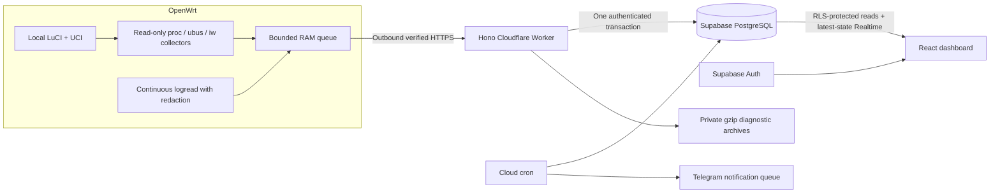

# Nicx Router Monitor

Outbound-only OpenWrt monitoring for the JIDU6111 and other compatible routers: a bounded RAM agent, LuCI configuration, an authenticated Cloudflare Worker, owner-isolated Supabase PostgreSQL and a live React dashboard.

The code runs real collectors and database ingestion. It contains no production demo data. Cloud deployment, actual-router installation and hardware performance validation require your accounts/router; they are tracked separately from local tests in [the implementation checklist](docs/implementation-checklist.md). Do not treat local simulation as router verification.



## Local development

Use Node22.22+ and pnpm10.33.2. In WSL Ubuntu:

```sh
cd nicx-router-monitor
pnpm install --frozen-lockfile --store-dir "$PWD/node_modules/.release-store"
pnpm test
pnpm test:database
pnpm test:router
pnpm typecheck
pnpm build
python3 -B scripts/dev-stack.py
```

For a shared hosted dashboard and API, use the [native Cloudflare Development Preview](../docs/release-operations.md#cloudflare-development-preview). Use the disposable stack below for local integration tests.

Full-stack development requires Docker Engine 28 or later and a Supabase CLI with `supabase start --network-id` support. The command verifies that local Supabase ports are bound to loopback before starting the dashboard. The command creates a local database, starts the Worker and dashboard on free loopback ports, enrolls a simulated router and checks that the fixture owner can read its sample. It prints temporary login details. Press Ctrl+C to remove the session, or add `--check` to verify owner sign-in and the simulated router in Chromium before exiting. Install the test browser with `pnpm exec playwright install chromium` for `--check`. Each session uses its own project and development credentials. A later run can reclaim abandoned sessions. Use `--cleanup` to run that cleanup without starting the stack. Fast database tests use embedded PostgreSQL and work without Docker.

PowerShell can run the same pnpm commands from the Windows checkout path. Package cross-compilation and shell fixture tests run under WSL/Linux. See [deployment](docs/deployment.md) for cloud setup and [router installation](docs/router.md) for package installation/enrollment.

## Features and evidence

- Versioned bounded batches, strict validation, token hashing, one-use enrollment, rotation/revocation, database transaction rate limits and idempotency.
- Current CPU/memory/network metrics with reset-aware deltas, modular sparse detail and optional probes/Wi-Fi/process diagnostics. Unsupported hardware values remain absent and explained.
- Continuous grouped/redacted logs, prioritized bounded RAM queue, immutable upload retries, verified TLS, procd lifecycle, UCI and modern LuCI.
- Supabase Auth/RLS, time-range queries, aggregate history, WAN/USB bandwidth totals, retention/storage accounting, cloud offline/threshold/event alerts and leased Telegram retries.
- Twelve data-bound dashboard sections, desktop/mobile navigation, dark/light modes, timezone preferences, zoomable charts, exports, filtered paginated logs and device management.
- Private compressed diagnostic archiving and deferred object cleanup on retention or device removal.

The exact implemented collectors and limitations are in [collector reference](docs/collectors.md), [compatibility and limits](docs/limitations.md), and [test evidence](docs/verification.md). These are more precise than a blanket claim that every requested statistic exists on every firmware.

## Documentation

| Topic | Reference |
| --- | --- |
| Architecture and decisions | [decisions](docs/decisions.md), [wire contracts](docs/contracts.md) |
| Current platform research | [research and official sources](docs/research.md) |
| Setup and automation | [deployment](docs/deployment.md) |
| Router / SDK / LuCI | [installation and configuration](docs/router.md), [collectors](docs/collectors.md) |
| API and security | [API](docs/api.md), [security and privacy](docs/security.md) |
| Database / RLS / rollups | [database](docs/database.md) |
| Free-tier sizing | [resource budgets](docs/resource-budgets.md) |
| Dashboard | [dashboard](docs/dashboard.md) |
| Operations / backup / upgrade | [operations](docs/operations.md) |
| Tests and measurements | [verification](docs/verification.md), [benchmarks](benchmarks/README.md) |
| Acceptance and remaining work | [checklist](docs/implementation-checklist.md), [limitations](docs/limitations.md) |

No inbound router ports, firewall changes, kernel patches, public database writes, disabled certificate checks or remote shell are needed. New code is MIT licensed; dependencies retain their own licenses.
